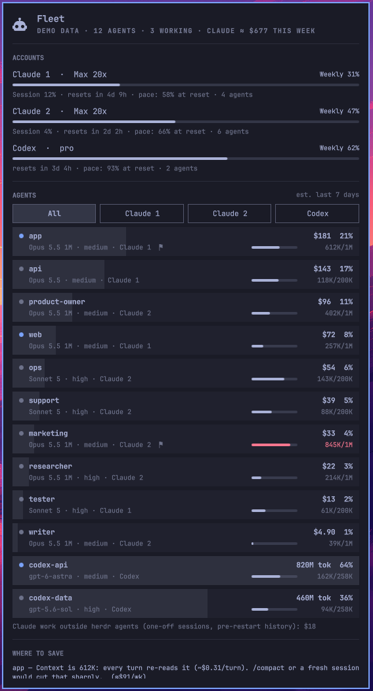
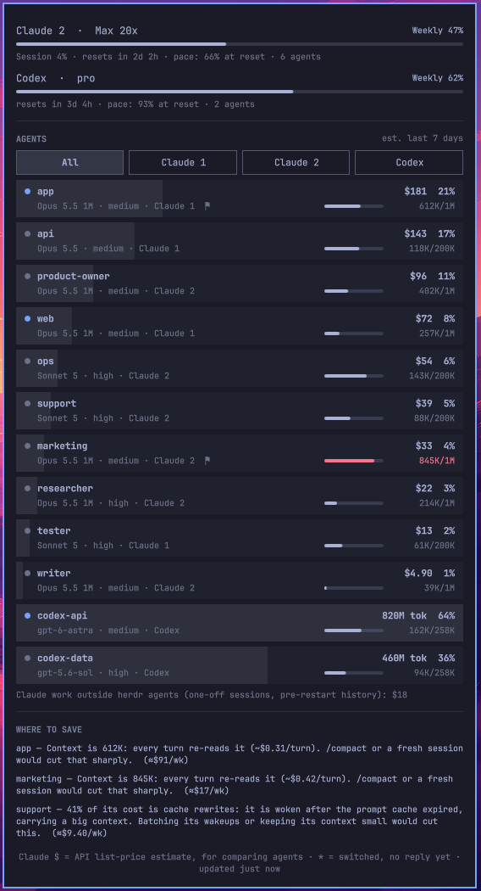

# Agent Fleet for Omarchy

A status-bar widget for [Omarchy](https://omarchy.org) that shows every AI coding agent you run under
[herdr](https://herdr.dev) at a glance: which Claude or Codex account it's using, which model and
effort, how full its context window is, and roughly how much of your plan it has used this week.
It also tells you where you could save.

<p align="center">
  
  &nbsp;
  
</p>

<sub>Screenshots use the built-in demo data (`agent-fleet demo`), not a real fleet.</sub>

## Why

Running a dozen agents across two Claude subscriptions and a Codex plan, the questions that matter are
simple and surprisingly hard to answer: which agents are eating the allowance, which account will run out
first, and what could be cheaper. Omarchy's own Agents panel shows usage per **account**; this shows it per
**agent**.

The single most useful thing it shows is context size. On Claude, nearly all of an agent's cost is
re-reading its own conversation on every turn, so an agent sitting at 800K tokens of context costs many
times more per turn than one at 100K, whatever the model. Output and "thinking" are usually a few percent.

## What it shows

**Accounts:** each Claude account (one per `CLAUDE_CONFIG_DIR`) and Codex, with the plan, weekly and
session usage, time to reset, the pace it's on for the reset, and how many agents it's carrying.

**Agents:** one row per herdr agent, heaviest first:

- status dot (working, idle, or gone)
- model and effort (`*` means you've switched model and it hasn't replied since)
- which account it's on
- context used against its window (red above 80%)
- estimated cost over the last 7 days and its share of the total (Codex: tokens)
- a flag if there's a suggestion for it

Hover a row for today's figures, request count, cache hit rate, median reply length, last activity and its
suggestions. Click a row to jump to that agent's herdr pane.

**Where to save:** a ranked list, for example:

- context large enough that every turn is expensive (suggests `/compact` or a fresh session)
- a large share of cost spent rewriting the prompt cache (an agent woken up after its cache expired, carrying
  a big context)
- an Opus agent that mostly gives short replies (a Sonnet model may do)
- an agent on a timer loop running on a premium model
- an agent on an account you've marked not to be used, or on a different model from your policy file

The same information is in the terminal:

```
$ agent-fleet
AGENT              ACCOUNT    STATE     MODEL           EFFORT  CONTEXT        WEEK $   TODAY $  SHARE
app                claude-1   working   Opus 5.5 (1M co medium  612K/1M       $181.40    $36.28    21%
api                claude-1   idle      Opus 5.5        medium  118K/200K     $142.90    $28.58    17%
product-owner      claude-2   idle      Opus 5.5 (1M co medium  402K/1M        $96.30    $19.26    11%
ops                claude-2   idle      Sonnet 5        high    143K/200K      $54.20    $10.84     6%
marketing          claude-2   idle      Opus 5.5 (1M co medium  845K/1M        $33.10     $6.62     4%
...
```

## Requirements

- Omarchy with its Quickshell shell (the one with `omarchy plugin` and the built-in Agents panel)
- [herdr](https://herdr.dev), which is where agent names come from
- Claude Code and/or the Codex CLI
- Python 3.10 or newer
- Linux (it reads process details from `/proc`)

## Install

```bash
omarchy plugin add https://github.com/netsensia/omarchy-agent-fleet.git --enable --yes
~/.config/omarchy/plugins/netsensia.agent-fleet/install.sh
```

Or clone it anywhere and run `./install.sh`, which links the checkout into Omarchy's plugin folder.

The installer puts `agent-fleet` in `~/.local/bin`, adds two systemd user timers (collect every minute,
refresh extra accounts' limits every 5 minutes), takes a first reading, enables the widget and places it
next to Omarchy's Agents icon. It's safe to re-run, for example after `omarchy plugin update`.

If you edit the plugin's QML, run `omarchy-restart-shell`: the shell keeps the old code on a hot reload.

### Try it with sample data

```bash
agent-fleet demo        # the widget shows made-up agents
agent-fleet demo --off  # back to your real fleet
```

## Multiple Claude accounts

Claude Code picks its account from `CLAUDE_CONFIG_DIR` (default `~/.claude`). Agent Fleet treats every
`~/.claude` and `~/.claude-*` folder as an account and reads each running agent's own environment to see
which one it's on, so moving an agent between accounts shows up within a minute.

Omarchy's usage collector only reads `~/.claude`. The `agent-fleet limits` timer runs that same collector
for each extra account and saves the result alongside, so the extra accounts also get their own tabs in
Omarchy's Agents panel.

## Configuration

Optional. Copy `config.example.json` to `~/.config/agent-fleet/config.json` and keep only what you need.

| Key | What it does |
|---|---|
| `accounts` | List the Claude accounts yourself: `configDir`, a display `name`, and `forbidden: true` (with a `note`) for an account agents must never use. Forbidden accounts are flagged in red and their limits are never fetched. |
| `codexHome` | Where Codex keeps its sessions, if not `~/.codex` (a running agent's own `CODEX_HOME` wins). |
| `prices` | Override the per-model price table: `[input, output, cache read, cache write]` in USD per million tokens, matched by model-name prefix. |
| `pricesAssumed` | Models whose prices are guesses, so the snapshot can say so. |
| `policyFile` | A text file of `<agent> <model>` lines. Agents running a different model family get flagged. |
| `loopAgents` | Names of agents that run on timers, so premium models on them get flagged. |

## How the numbers work

- **Everything is read locally.** Agents come from `herdr agent list`; their account, pane and session come
  from `/proc`; usage comes from Claude Code's and Codex's own session files. The only network calls are
  Omarchy's collector reading your plan limits with the login you already have.
- **Claude cost is an estimate at API list prices.** It's there to compare agents, not to predict a bill:
  on a flat subscription, an agent's share of estimated cost is a good stand-in for its share of the
  allowance. Codex is shown in tokens.
- **Context** is the size of the agent's most recent request (input plus cache). The window is worked out
  from the model you last switched to and the account's default, so a `[1m]` model shows a 1M window.
- **Pace** is projected from the weekly figure's change over the last few hours, once there's an hour of
  history.
- Session files are read incrementally, so after the first run each pass only reads what was added.
- Claude work that isn't a herdr agent (one-off sessions, history from before an agent restarted) is
  counted separately at the bottom.

## Uninstall

```bash
~/.config/omarchy/plugins/netsensia.agent-fleet/uninstall.sh
omarchy plugin remove netsensia.agent-fleet
```

Your settings and data (`~/.config/agent-fleet`, `~/.local/state/agent-fleet`) are left in place.

## Credits

The panel follows the layout and components of Omarchy's built-in Agents panel, and plan limits come from
Omarchy's own usage collector. Both are part of [Omarchy](https://github.com/basecamp/omarchy), MIT
licensed. Agent names and panes come from [herdr](https://herdr.dev).

## License

MIT. See [LICENSE](LICENSE).
